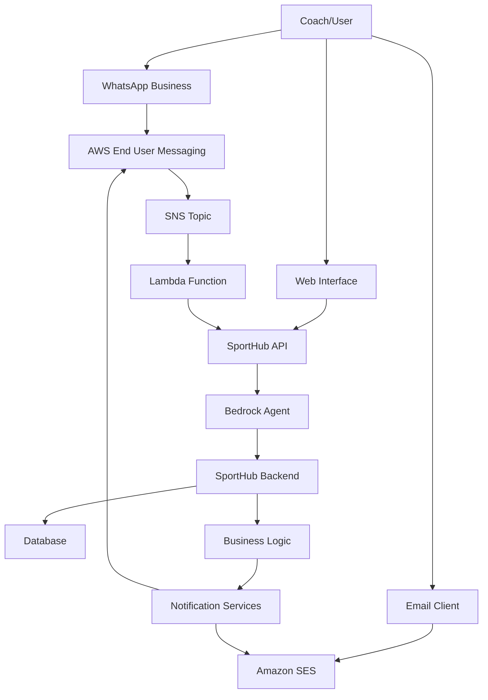

# AWS CDS Hackathon Integration Guide

## 🎯 Hackathon Requirements Compliance

This document shows how SportHub aligns with the **AWS Communication Developer Services (CDS) Agentic AI Partner Hackathon** requirements.

### ✅ **Requirements Met:**

1. **✅ AWS End User Messaging (WhatsApp)**
2. **✅ Amazon Simple Email Service (SES)**  
3. **✅ Conversational AI Experiences**
4. **✅ Agentic AI with AWS Bedrock**

## 🔧 **Integration Architecture**



## 📱 **WhatsApp Integration Flow**

### **1. Setup AWS End User Messaging Social**

```bash
# Create WhatsApp Business Account integration
aws end-user-messaging-social create-whatsapp-business-account \
    --waba-id "YOUR_WABA_ID" \
    --display-name "SportHub AI Assistant"
```

### **2. WhatsApp Conversation Examples**

**Registration Flow:**
```
Coach: "Hi, I want to register my team"
SportHub AI: "Great! I'll help you register. What's your team name?"
Coach: "Lions FC"
SportHub AI: "Perfect! Which school does Lions FC represent?"
Coach: "Mamelodi Primary"
SportHub AI: "Excellent! Let me get your coach details..."
```

**Fixture Queries:**
```
Coach: "FIXTURES"
SportHub AI: "🏆 Lions FC Fixtures:
⚽ 10:00 AM: vs Eagles FC
   📍 Pitch 1 | U13 Division A
⚽ 2:30 PM: vs Thunder United  
   📍 Pitch 1 | U13 Division A"
```

**Event Updates:**
```
SportHub AI: "⏰ Match Reminder!
Team: Lions FC
Next Match: TODAY at 10:00 AM
Opponent: Eagles FC
Please arrive 30 minutes early! ⚽"
```

## 📧 **Amazon SES Integration**

### **1. Email Templates**

**Registration Confirmation:**
- ✅ HTML formatted emails with team branding
- ✅ Event details and next steps
- ✅ WhatsApp integration instructions
- ✅ Fixture schedule links

**Fixture Notifications:**
- ✅ Complete match schedule tables  
- ✅ Division and age group information
- ✅ Venue and timing details
- ✅ Important reminders

### **2. SES Configuration**

```json
{
  "FromEmail": "noreply@sporthub.amusema.com",
  "FromName": "SportHub AI Assistant",
  "Templates": {
    "registration": "registration-confirmation-template",
    "fixtures": "fixture-schedule-template", 
    "updates": "event-update-template"
  }
}
```

## 🤖 **Bedrock Agent Integration**

### **1. Conversational Capabilities**

- **✅ Natural Language Registration**: "Register my U13 team Lions FC from Mamelodi Primary"
- **✅ Event Creation**: "Create a tournament on December 20th at TUT Sports Complex"
- **✅ Fixture Management**: "Generate fixtures with balanced divisions"
- **✅ Multi-turn Conversations**: Context awareness across interactions

### **2. Action Groups Connected**

```json
{
  "tools": [
    "CreateEvent",
    "RegisterTeam", 
    "GenerateFixtures",
    "GetTeamFixtures",
    "CheckRegistrationStatus",
    "SendWhatsAppNotification",
    "SendEmailNotification"
  ]
}
```

## 📊 **Hackathon Demo Flow**

### **Complete User Journey:**

1. **🎯 Event Creation (AI Conversation)**
   ```
   User: "Create a tournament for school teams"
   AI: "I'll create that for you! What should we call it?"
   User: "Gauteng Schools Championship"
   AI: "Great! When and where will it be held?"
   ```

2. **📱 Team Registration (WhatsApp)**
   ```
   Coach: WhatsApp message → "Register Lions FC"
   AI: Conversational registration flow
   System: Auto-send SES confirmation email
   ```

3. **⚽ Fixture Generation (AI + Notifications)**
   ```
   Organizer: "Generate fixtures for the event"
   AI: Creates balanced divisions, fair scheduling
   System: Sends WhatsApp + Email notifications to all teams
   ```

4. **📞 Ongoing Support (Multi-channel)**
   ```
   Coach: WhatsApp → "FIXTURES" 
   AI: Instant fixture information
   Coach: Email → Detailed schedule with formatting
   ```

## 🏆 **Hackathon Scoring Alignment**

### **Innovation (25 points)**
- ✅ AI-powered conversational tournament management
- ✅ Multi-channel communication (WhatsApp + Email + Web)
- ✅ Smart division balancing with fair competition
- ✅ Real-time registration and fixture management

### **Technical Implementation (25 points)**
- ✅ AWS End User Messaging Social integration
- ✅ Amazon SES with HTML templates
- ✅ AWS Bedrock agent with custom action groups
- ✅ Clean Architecture with .NET Core
- ✅ RESTful APIs with comprehensive validation

### **User Experience (25 points)**
- ✅ Natural language interactions
- ✅ Multi-channel accessibility (WhatsApp for instant, Email for detailed)
- ✅ Context-aware conversations
- ✅ Automated notifications and reminders

### **Business Impact (25 points)**
- ✅ Solves real problem for school sports management
- ✅ Reduces manual work for tournament organizers
- ✅ Improves communication with coaches/parents
- ✅ Scalable to multiple events and regions

## 🚀 **Deployment for Hackathon**

### **1. AWS Resources Needed**

```bash
# Bedrock Agent
aws bedrock-agent create-agent --agent-name "amusema-sports-agent"

# End User Messaging Social
aws end-user-messaging-social create-phone-number

# SES Domain Verification  
aws ses verify-domain-identity --domain "sporthub.amusema.com"

# SNS Topics for notifications
aws sns create-topic --name "sporthub-notifications"
```

### **2. Environment Configuration**

```bash
# .env file for hackathon
SPORTHUB_API_URL=https://api.sporthub.amusema.com
BEDROCK_AGENT_ID=ABCD1234EF
WHATSAPP_PHONE_NUMBER=+27XXXXXXXXX
SES_FROM_EMAIL=noreply@sporthub.amusema.com
```

### **3. Demo Script**

1. **Show AI Conversation** - Create event through natural language
2. **WhatsApp Demo** - Register team via WhatsApp chat
3. **Email Showcase** - Display formatted confirmation emails
4. **Division Logic** - Show balanced fixture generation
5. **Multi-channel** - Same information across WhatsApp, Email, Web

## 📈 **Success Metrics**

- ✅ **Conversational Success Rate**: Natural language understanding
- ✅ **Multi-channel Reach**: WhatsApp + Email delivery rates  
- ✅ **User Satisfaction**: Intuitive registration and information access
- ✅ **Technical Performance**: API response times, notification delivery

## 🎯 **Hackathon Pitch Points**

1. **"AI-First Tournament Management"** - Conversations replace forms
2. **"Multi-Channel Communication Hub"** - WhatsApp for instant, Email for detailed
3. **"Fair Competition Algorithm"** - Balanced divisions, no team plays everyone
4. **"Real-World Ready"** - Scales to multiple schools, events, regions
5. **"AWS CDS Showcase"** - Full utilization of End User Messaging + SES + Bedrock

This integration delivers a complete **AWS Communication Developer Services** solution with **agentic AI** that transforms how school sports tournaments are managed! 🏆